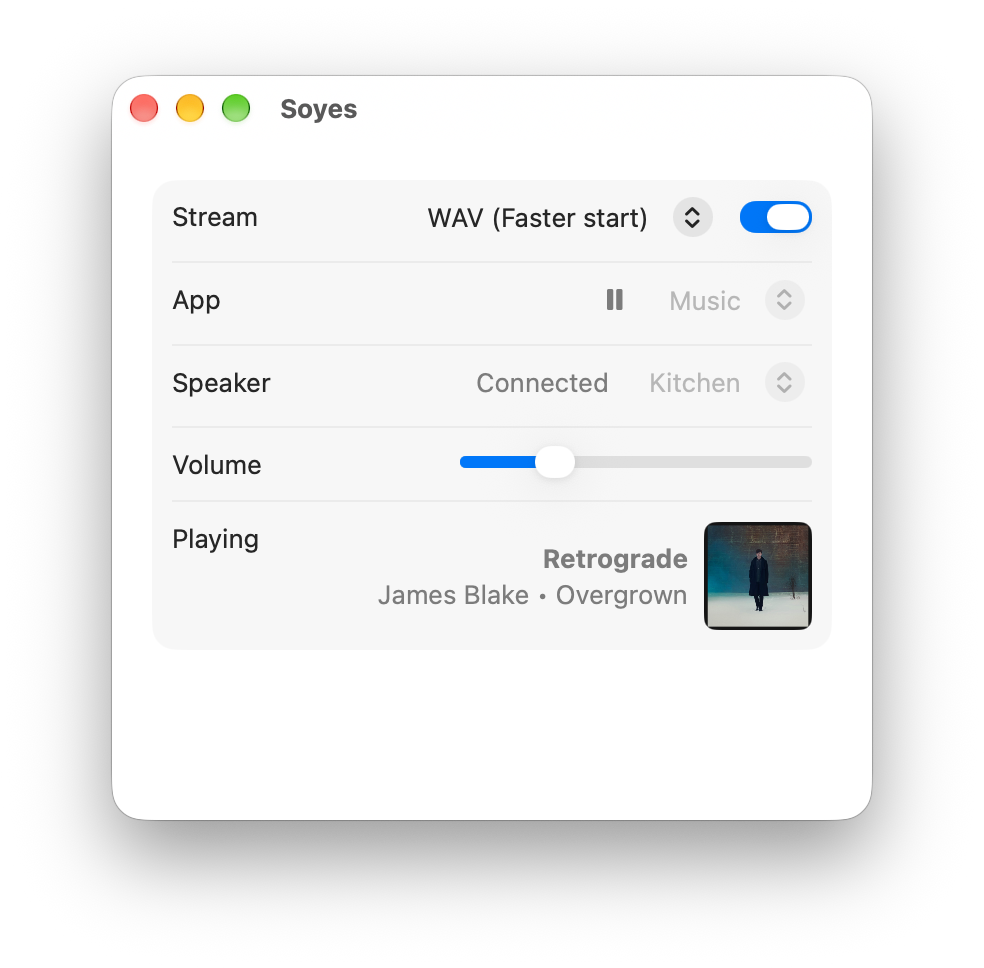

# Soyes

Soyes sends the audio from one Mac app to a Sonos speaker on your Wi-Fi.



Choose an app and a speaker, then turn Stream on. The menu beside that switch chooses WAV for a faster start, or AAC for a steadier stream. Soyes captures that app, mutes it on the Mac, and plays it through the speaker. The speaker chimes when Stream connects it, and its status light blinks while it connects or while audio is on its way after you press play. The speaker mutes the moment the app pauses. The play and pause button beside the app name controls that app. The volume slider sets the speaker’s volume. Command-F12 raises it, Command-F11 lowers it, and Command-F10 mutes it. Playing shows the track, artist, and album when the app provides them, and the cover when that app is Music.

## Requirements

- macOS 14.4 or later
- A Sonos speaker on the same network

## Build

```bash
./build.sh
open Soyes.app
```

The first time Soyes opens, allow it in System Settings → Privacy & Security → Audio Capture.

GitHub Actions builds every pull request. A push to main publishes a numbered release of the app.

## How it works

Soyes finds speakers with Bonjour (`_sonos._tcp`) and controls the chosen one over local UPnP on port 1400. It captures the selected app with a Core Audio process tap and serves that audio on the local network. The menu beside Stream chooses WAV or AAC. Nothing goes through Sonos cloud or AirPlay.

Sonos waits for a fixed amount of data before it starts a stream, so AAC takes a few seconds to start while WAV starts in about half a second. Soyes connects as soon as it opens, as long as the speaker isn’t playing something else, and keeps the stream open with silence until there’s audio to send. Pausing keeps that connection. Choosing the other format starts it again. The status beside the speaker stays on Connecting until the speaker answers. It shows Not found only if the speaker keeps failing to answer, and In use when the speaker is already playing something else. Quitting puts the speaker back the way it was.

`scripts/probe-formats.py` measures how quickly a speaker starts each stream format. It needs [ffmpeg](https://ffmpeg.org/) (`brew install ffmpeg`). Quit Soyes, then run it from Terminal with `python3 scripts/probe-formats.py`.
